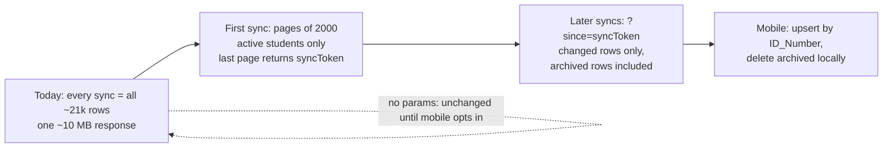

## Changes feed for `GET /sync/students`: paging plus "only what changed" for the mobile app

**TL;DR.** Production has about 21k students (your figure, not verifiable from this repo) and the mobile app downloads all of them on every sync, then saves them to its local database. That is like re-photocopying a whole phone book every morning to find the three pages that changed. We add an opt-in "changes feed" to the same endpoint: the first sync downloads the roster in chunks of 2,000; every later sync sends back a bookmark (`since`) and receives only students who changed since then, including newly archived ones so the app can remove them. The old no-parameter call keeps working until the mobile app moves, so nothing breaks on deploy. No database change. The mobile developer gets a plain-English, step-by-step guide (`docs/sync-students-mobile-contract.md`: checklist of what to change, example requests and responses, the algorithm, error handling, a test list) so they know exactly what to adjust on their side.

| | Today | After (mobile opts in) |
|---|---|---|
| First sync | 1 response, ~10 MB uncompressed, 21k rows | ~11 pages of 2,000 rows (~1 MB each) |
| Every later sync | the same ~10 MB | only changed rows (usually a handful) |
| Removing archived students | not possible (they are filtered out) | archived rows arrive in the delta with `isArchived: true` |

### Task Classification

```
Task Classification:
- Intent: ENHANCEMENT
- Workflow: docs/ai/prompts/feature-plan.md (plan) → docs/ai/execution.md (strict TDD)
- Task Size: Deep (new API contract with an external consumer on a gate-access roster; wrong cursor logic silently hides a student from mobile)
- Domain: Sync (mobile/offline pull) — `docs/ai/module-ownership-map.md` row "Sync (mobile/offline pull)"
- Risk: medium — read-only endpoint, but a skipped row means a missing student on a device
- Contract Areas: GET /sync/students request params + response envelope (mobile consumer, not in this repo)
- Next Action: user approves this plan, then Phase 0
```

### Flowchart (high-level, SVG)

`mcp__visualize__show_widget` is not available in this session, so the SVG is inline here and the mermaid block below is the same flow.

<svg xmlns="http://www.w3.org/2000/svg" viewBox="0 0 900 190" width="100%" role="img" aria-label="Problem to solution flow">
  <rect x="10" y="50" width="190" height="90" rx="8" fill="#fdecea" stroke="#c0392b"/>
  <text x="105" y="80" text-anchor="middle" font-size="13" font-family="sans-serif">Today</text>
  <text x="105" y="100" text-anchor="middle" font-size="11" font-family="sans-serif">every sync = all ~21k rows</text>
  <text x="105" y="118" text-anchor="middle" font-size="11" font-family="sans-serif">one ~10 MB response</text>
  <rect x="250" y="50" width="190" height="90" rx="8" fill="#eaf2fd" stroke="#2c6fbb"/>
  <text x="345" y="80" text-anchor="middle" font-size="13" font-family="sans-serif">First sync</text>
  <text x="345" y="100" text-anchor="middle" font-size="11" font-family="sans-serif">pages of 2,000, active only</text>
  <text x="345" y="118" text-anchor="middle" font-size="11" font-family="sans-serif">last page returns syncToken</text>
  <rect x="490" y="50" width="190" height="90" rx="8" fill="#eaf2fd" stroke="#2c6fbb"/>
  <text x="585" y="80" text-anchor="middle" font-size="13" font-family="sans-serif">Later syncs</text>
  <text x="585" y="100" text-anchor="middle" font-size="11" font-family="sans-serif">?since=syncToken</text>
  <text x="585" y="118" text-anchor="middle" font-size="11" font-family="sans-serif">changed rows only</text>
  <rect x="730" y="50" width="160" height="90" rx="8" fill="#e9f7ef" stroke="#1e8449"/>
  <text x="810" y="80" text-anchor="middle" font-size="13" font-family="sans-serif">Mobile app</text>
  <text x="810" y="100" text-anchor="middle" font-size="11" font-family="sans-serif">upserts by ID_Number,</text>
  <text x="810" y="118" text-anchor="middle" font-size="11" font-family="sans-serif">deletes archived locally</text>
  <path d="M200 95 H250 M440 95 H490 M680 95 H730" stroke="#555" stroke-width="2" fill="none"/>
  <path d="M243 89 L250 95 L243 101 M483 89 L490 95 L483 101 M723 89 L730 95 L723 101" stroke="#555" stroke-width="2" fill="none"/>
</svg>



### Task metadata

- Classification: `ENHANCEMENT` · `Deep` · Sync (mobile/offline pull) · medium
- Docs loaded: `planning.md, plan-template.md` (also read: `task-router.md`, `prompts/feature-plan.md`, `testing-strategy.md`, `agent-orchestration.md`, `execution.md`, `handoff.md`, `pr-evidence.md`, `contracts/api-contracts.md`, `core/safety.md`, `core/communication-contract.md`)
- Claims reversed while investigating:
  1. "Add an index on `students.updatedAt` (migration)." Reversed: at 21k rows the sort/filter is a few milliseconds without one, the sort key must be an expression over nullable columns (below), and an expression index adds a migration, a Round 0 persona and a migration test for no measured gain. Disproved if the local measurement in Phase 4 shows a page taking more than ~200 ms; then add the index as its own task.
  2. "`updatedAt` is never NULL." Reversed: `students.updatedAt` and `createdAt` are declared `TIMESTAMP DEFAULT CURRENT_TIMESTAMP` with no `NOT NULL` (`apps/backend/src/migrations/1710000000000-CreateSyncAndStudentTables.ts:26-27`). A NULL there would make a plain `updatedAt > x` comparison drop the student forever, so the sort key falls back to `createdAt`, then to epoch.
  3. "A JS `Date` can carry the cursor." Reversed: PostgreSQL `timestamp` has microseconds, JS `Date` has milliseconds, and a bulk sync stamps many rows with one identical microsecond value. A millisecond cursor compares lower than those rows and the next page restarts at the beginning of the batch, forever. The cursor therefore carries PostgreSQL's own text of the value. Disproved if the e2e case "students sharing one microsecond updatedAt" terminates with each row once while using a ms-truncated cursor.
  4. "Offset (`page`) paging is enough." Reversed: rows change while the app is mid-sync, so offsets skip or repeat rows. Keyset paging on `(sort key, id)` is stable.
- Root cause: n/a (enhancement). The needs-evidence for the problem is the endpoint code: `SyncService.getAllStudents` returns the whole table with no `take`/`skip` (`apps/backend/src/sync/sync.service.ts`), and the 21k figure is from the user.
- Gate-access invariants touched: none. (1) `studentMutationLock`: not touched; the endpoint is read-only and takes no lock. (2) BioStar deprovision rollback: no BioStar call, no write. (3) `Role` enum: no role check added or changed; the existing `JwtAuthGuard` stays. (4) `reports` writes: not touched. Because mobile treats this roster as who exists, correctness of "no student is skipped" is tested against real PostgreSQL (Phase 1 e2e).
- Detected running model: Sonnet 5.5 (`claude-sonnet-5-5`, from session configuration).
- Recommended model: `sonnet`, high reasoning for every phase; fallback `opus`, high. All phases use the same (tier, reasoning) pair, so no model-switch stop occurs. The persona subagents run on the `sonnet` alias (`docs/ai/agent-orchestration.md` "Runtime model").
- Branch: the session designates `claude/hopeful-gauss-2ctqv2` for pushes. PR #4 from that branch is merged (merge commit `d9f5891`), so per the merged-PR rule this follow-up restarts from `origin/main`. Local worktree branch: `enhancement/no-ticket-sync-students-feed` (from `scripts/new-task-worktree.sh`), pushed as `git push -u origin enhancement/no-ticket-sync-students-feed:claude/hopeful-gauss-2ctqv2`. This is a plain fast-forward (the remote head `4e2f6c3` is an ancestor of `origin/main`), so no force is needed. Rename to carry a Linear ID if one exists (`docs/ai/execution.md`).
- Release path: one branch → one PR into `main`, "Create a merge commit" (`docs/ai/handoff.md`). A PR is opened only when you ask for it.
- Required skills: `ecc:code-review`/`code-review` skill for Round 4; `security-review` skill via the `security-auditor` persona. `/qa` is not required (backend-only; the five-bucket sweep applies).
- Persona rounds (`docs/ai/agent-orchestration.md` "Round Structure"): Round 0 not needed (`No schema changes required.`) → Round 1 `project-manager` confirms the locked contract below → Round 1b `test-engineer` alone writes RED → Round 2 `nestjs-backend-dev` alone (backend-only; no `nextjs-frontend-dev`) → Round 3 main session verifies against the contract → Round 4 `test-engineer` + `code-reviewer` + `security-auditor` together. `docs/`, `.ai-engineering/` edits are done by the main session (File Ownership rule 5). Every dispatch prompt carries the caveman-ultra instruction, the Senior Staff persona line from `AGENTS.md`, and the File Ownership Rule verbatim.
- Execution preflight: `git fetch origin`, then `scripts/new-task-worktree.sh enhancement sync-students-feed`.
- Discovery note: Graphify could not be used for discovery: `which graphify` is empty in this container and no graphify skill is listed. Discovery used Grep/Read (the fallback `planning.md` allows). The Graphify closeout (`/graphify . --update`) must run at execution if the skill is available there; if it is not, the final report states it was not run.

### Verified facts (each traced to a file read this session)

- `GET /sync/students`: `SyncController.getAllStudents()` (`apps/backend/src/sync/sync.controller.ts`) → `SyncService.getAllStudents()` (`sync.service.ts`). After PR #4 it runs `find({ select: <all columns except Photo>, where: { isArchived: false } })` with no `take`/`skip`/`order`. Only callers of `getAllStudents`: the controller and the two sync specs (grep of `apps/backend`). No portal-web caller (`docs/ai/contracts/api-contracts.md` row for `/sync/students`). The real consumer is the external mobile app.
- Cache: `HttpCacheInterceptor.trackBy` keys on `` `${request.url}:${JSON.stringify(request.query)}` `` (`apps/backend/src/interceptors/cache.interceptor.ts:35`), so every distinct page/cursor/since URL is its own cache entry for `@CacheTTL(300000)`. Interceptors run before pipes, so the key uses the raw query.
- `Student.id` is `@PrimaryGeneratedColumn()` (int), `updatedAt` is `@UpdateDateColumn()`, `createdAt` is `@CreateDateColumn()` (`apps/backend/src/students/entities/student.entity.ts`); the table's `updatedAt`/`createdAt` columns are nullable (`1710000000000-CreateSyncAndStudentTables.ts:26-27`). `isArchived` is `BOOLEAN DEFAULT false`, also nullable there (a NULL `isArchived` row is already excluded by today's `isArchived = false` filter; unchanged, see Out of scope).
- Student writes in `database-sync/` use `studentRepository.update/save` or QueryBuilder `.update(Student)` (grep: `database-sync-dasma-path.service.ts`, `database-sync-main-path.service.ts`, `database-sync.service.ts:879,954`); no raw `UPDATE students` SQL and no hard `delete` of students were found. TypeORM sets `updatedAt` on those. This last claim is library behaviour; the e2e case "a repository update moves the student into the next delta" is the proof and would disprove it if the row does not reappear.
- `updatedAt` stamps a transaction's start time in PostgreSQL (`CURRENT_TIMESTAMP`), so one bulk sync transaction gives many rows the same microsecond value, and a long transaction can commit after a mobile pull has read past that timestamp.
- Validation pattern with no global pipe: `@Query(new ValidationPipe({ transform: true })) query: Dto` (`apps/backend/src/students/students.controller.ts`, `generateStudentsCsv`). DTO decorators style: `apps/backend/src/common/dto/base-pagination.dto.ts` (`@Type(() => Number) @IsInt() @Min(1) @IsOptional()`). `class-validator` ^0.14.3 and `class-transformer` ^0.5.1 are already dependencies.
- E2E pattern: `apps/backend/test/dasma-sync-biostar.e2e-spec.ts` builds a `DataSource` from `DB_*` env with `migrationsRun: true` against a disposable database, `TRUNCATE`s `students` in `beforeEach`. `jest-e2e.json` runs spec files in parallel workers, so a second spec sharing that database would race the `TRUNCATE`; the new e2e therefore uses its own database.
- `compression()` is enabled (`apps/backend/src/main.ts:105`). Size estimate: about 470 bytes per row of JSON (the sample response earlier in this session) × 21k ≈ 10 MB uncompressed. Wire size is not measured; Phase 4 measures it.
- Mobile's local write strategy is unknown. You decided we propose the efficient design and mobile adjusts.
- Dev-mode: in `NODE_ENV=development` with no token the global guard fabricates a SUPER_ADMIN (`docs/ai/agent-orchestration.md` auth briefing), which the Phase 4 smoke test uses; production requires a JWT.

### Contract (locked; handed to the mobile dev as `docs/sync-students-mobile-contract.md`)

`GET /sync/students?limit=<1..5000>&cursor=<opaque>&since=<opaque>` (all optional; `limit` default 2000 when any parameter is present).

| Call | Behaviour |
|---|---|
| no parameters | Unchanged legacy: `{ "students": [...] }`, all non-archived students, no `Photo`. Existing mobile builds keep working. |
| `limit` only | First sync. Non-archived students ordered by `(sort key, id)`, one page. |
| `cursor` | Next page of the same pull, exact continuation (no overlap). Cannot be combined with `since` (400). |
| `since` | Delta. Students changed since the last completed sync, **including `isArchived: true` rows** (mobile deletes them locally). The server re-sends the 10 minutes before the token so a late-committing sync batch is not missed. |

Response whenever any parameter is present: `{ "students": [...], "nextCursor": "<token>" | null, "syncToken": "<token>" | null }`. `nextCursor` is null on the last page. `syncToken` is set only on the last page; mobile saves it and sends it as `since` next time. An empty delta returns the same `since` back as `syncToken`; an empty first sync returns `null`.

Sort key (one definition, used for order, cursor and `since`): `COALESCE("student"."updatedAt", "student"."createdAt", TIMESTAMP 'epoch')`, then `student.id`.

Token: base64url of `<mode>|<sort key as PostgreSQL text>|<id>`, `mode` = `i` (first sync) or `d` (delta). Opaque to mobile. Malformed token → 400.

Mobile requirements: (1) apply every page with an idempotent upsert by `ID_Number` (the overlap and any retry repeat rows); (2) treat `isArchived: true` as "delete locally"; (3) save `syncToken` only after the last page is applied, in one transaction or a staging table, so a crash cannot leave half a roster; (4) on any doubt, drop the saved token and run a fresh first sync. Archived rows never appear in a first sync, so a first sync must replace the local table rather than merge into stale data.

### Decisions (simplest correct approach; each rejected simpler option named)

- Opt-in params on the existing route, not a new endpoint: keeps one URL, one auth path and one cache policy; the no-parameter path stays byte-for-byte what PR #4 shipped.
- No migration (see Claims reversed 1). Rejected simpler alternative: `id`-only keyset paging. It would page correctly but cannot produce deltas, which is where the saving is.
- Overlap of 10 minutes is applied on the server so there is one place to tune. The number is a proposal: the longest Dasma batch transaction was not measured (Open item 3). A wrong guess only costs repeated rows, never a missed one, as long as no transaction outlives the window.
- `syncToken` may drift back by at most the overlap window when a delta contains only overlap rows; it then re-sends the same few rows next time. Harmless; documented rather than adding a timestamp comparison in application code.
- New small pure module for the token codec (`sync-students-feed-token.ts`) rather than private methods in the service: it has its own failure modes (malformed input) and is unit-tested without Nest. Reuse candidates inspected: `BasePaginationDto` (page/offset, wrong model), `StudentsService.findAll` (offset paging with `getManyAndCount`, wrong model and does an extra COUNT).
- Out of scope: other payload fields (e.g. `biostar_row_hash`), `/sync/employees`, a NULL `isArchived` row, `Photo` delivery for mobile (separate decision), an index.

### Phase 0 — Setup (main session; `sonnet`, high)

1. `git fetch origin && scripts/new-task-worktree.sh enhancement sync-students-feed`, then `cd` into the printed worktree. Read `docs/ai/execution.md` first (already read for this plan).
2. In the worktree: `mkdir -p docs/plans` is not needed (the folder exists). Copy this approved plan to `docs/plans/sync-students-feed.md` and commit it alone: `docs(plan): changes feed for GET /sync/students`.
3. Create the e2e database once: `createdb -h localhost -p 5433 -U postgres dlsu_gate_system_e2e_feed` (if `.env` sets other `DB_*` values, use them).

Done: worktree exists on `enhancement/no-ticket-sync-students-feed`, plan committed, database exists.

### Phase 1 — RED (`sonnet`, high) — Round 1b, `test-engineer` alone

Write every file below, cases ordered `error:` > `edge:` > `regression:` > `happy:` inside each file. Run `cd apps/backend && npx tsc --noEmit` is NOT expected to pass yet (the modules do not exist, which is a valid RED: "a test file that cannot load yet because its module does not exist"). Run `npm run tdd:red`, paste the failing output, commit the tests alone as `test(sync): RED for the /sync/students changes feed`. No `apps/*/src` non-spec file is touched in this phase.

**Test Matrix**

| Layer | Required | File | Cases (exact) |
|---|---|---|---|
| Token codec unit | required | `apps/backend/src/sync/sync-students-feed-token.spec.ts` (new) | error: malformed tokens decode to null; edge: keys with and without a fraction round-trip; regression: tokens are URL-safe; happy: encode then decode returns the same position |
| DTO unit | required | `apps/backend/src/sync/dto/sync-students-query.dto.spec.ts` (new) | error: `limit` outside 1–5000 or non-integer; error: `cursor`/`since` with characters outside base64url or longer than 200; edge: no params valid; edge: limits 1 and 5000 valid; happy: `limit` string becomes a number |
| Service unit (feed) | required | `apps/backend/src/sync/sync-students-feed.service.spec.ts` (new) | error ×4, edge ×9, regression ×3, happy ×1 (listed in the file below) |
| Service unit (PR #4 tests) | required, unchanged | `apps/backend/src/sync/sync.service.spec.ts` | no edits; must still pass (legacy path regression proof) |
| Controller unit | required | `apps/backend/src/sync/sync.controller.spec.ts` | edge: query forwarded to the service untouched; regression: no-argument call still asks for the whole roster (`{}`) |
| Real-PostgreSQL e2e | required (`database-sync` is not touched, but this is the only proof of the SQL; `docs/ai/testing-strategy.md` "Mandatory Test Layers" allows it and the cursor SQL cannot be proven by mocks) | `apps/backend/test/sync-students-feed.e2e-spec.ts` (new) | error ×2, edge ×3, regression ×4, happy ×2 (file below) |
| Migration | not required: `No schema changes required.` (no migration file, no entity change) | — | — |
| Frontend | not required: no portal-web caller (verified) | — | — |
| Smoke | required: app boots and the endpoint answers | Phase 4 manual run | `bun run dev:backend`, `curl` with and without params |

Five-bucket map (`.ai-engineering/agents/qa.md`): happy → feed happy cases; error → malformed token/DTO/db failure; edge → empty, archived, NULL timestamps, last page, empty delta; rare/boundary → one-microsecond ties, `limit` 1/5000, id 2147483648, overlap boundary (11 vs 5 minutes); performance-relevant → fetch `limit + 1` (no COUNT), one query per page, `Photo` never selected.

1. New file `apps/backend/src/sync/sync-students-feed-token.spec.ts` (full content):

```ts
import { decodeFeedToken, encodeFeedToken } from './sync-students-feed-token';

const tokenOf = (raw: string) => Buffer.from(raw, 'utf8').toString('base64url');

describe('sync students feed token', () => {
  it('error: decodes anything that is not a feed token to null', () => {
    const bad = [
      '',
      'not-a-token',
      tokenOf('x|2026-01-01 00:00:00|1'),
      tokenOf('d|2026-13-45 00:00:00|1'),
      tokenOf('d|2026-01-01 24:00:00|1'),
      tokenOf('d|2026-01-01 00:00:00|-1'),
      tokenOf('d|2026-01-01 00:00:00|2147483648'),
      tokenOf('d|2026-01-01 00:00:00.1234567|1'),
      tokenOf('d|2026-01-01|1'),
    ];

    for (const token of bad) {
      expect(decodeFeedToken(token)).toBeNull();
    }
  });

  it('edge: round-trips a key with microseconds and a key without a fraction', () => {
    const withFraction = {
      mode: 'd' as const,
      key: '2026-01-01 00:00:00.123456',
      id: 42,
    };
    const without = { mode: 'i' as const, key: '1970-01-01 00:00:00', id: 1 };

    expect(decodeFeedToken(encodeFeedToken(withFraction))).toEqual(
      withFraction,
    );
    expect(decodeFeedToken(encodeFeedToken(without))).toEqual(without);
  });

  it('regression: a token is URL-safe, so it needs no escaping in a query string', () => {
    const token = encodeFeedToken({
      mode: 'd',
      key: '2026-01-01 00:00:00.5',
      id: 2147483647,
    });

    expect(token).toMatch(/^[A-Za-z0-9_-]+$/);
  });

  it('happy: decode(encode(position)) returns the same position', () => {
    const position = { mode: 'i' as const, key: '2026-10-14 08:30:15.25', id: 7 };

    expect(decodeFeedToken(encodeFeedToken(position))).toEqual(position);
  });
});
```

2. New file `apps/backend/src/sync/dto/sync-students-query.dto.spec.ts` (full content):

```ts
import { plainToInstance } from 'class-transformer';
import { validate } from 'class-validator';

import {
  SYNC_STUDENTS_MAX_LIMIT,
  SyncStudentsQueryDto,
} from './sync-students-query.dto';

const check = (plain: Record<string, unknown>) =>
  validate(plainToInstance(SyncStudentsQueryDto, plain));

describe('SyncStudentsQueryDto', () => {
  it('error: rejects a limit that is not an integer between 1 and 5000', async () => {
    for (const limit of ['0', '-1', '1.5', 'abc', String(SYNC_STUDENTS_MAX_LIMIT + 1)]) {
      const errors = await check({ limit });
      expect(errors.map((e) => e.property)).toContain('limit');
    }
  });

  it('error: rejects a cursor or since with characters outside base64url, or longer than 200', async () => {
    for (const field of ['cursor', 'since']) {
      for (const value of ['a b', 'a/b', 'a+b', 'a=', '../x', 'a'.repeat(201)]) {
        const errors = await check({ [field]: value });
        expect(errors.map((e) => e.property)).toContain(field);
      }
    }
  });

  it('edge: accepts a request with no parameters at all', async () => {
    await expect(check({})).resolves.toHaveLength(0);
  });

  it('edge: accepts the smallest and the largest limit', async () => {
    await expect(check({ limit: '1' })).resolves.toHaveLength(0);
    await expect(
      check({ limit: String(SYNC_STUDENTS_MAX_LIMIT) }),
    ).resolves.toHaveLength(0);
  });

  it('happy: turns the limit query string into a number', () => {
    expect(plainToInstance(SyncStudentsQueryDto, { limit: '25' }).limit).toBe(25);
  });
});
```

3. New file `apps/backend/src/sync/sync-students-feed.service.spec.ts` (full content):

```ts
import { Test, TestingModule } from '@nestjs/testing';
import { BadRequestException } from '@nestjs/common';
import { getRepositoryToken } from '@nestjs/typeorm';

import { SyncService } from './sync.service';
import {
  decodeFeedToken,
  encodeFeedToken,
} from './sync-students-feed-token';
import { Student } from '../students/entities/student.entity';
import { Employee } from '../employee/entities/employee.entity';

describe('SyncService.getAllStudents — changes feed', () => {
  let service: SyncService;
  let builder: Record<string, jest.Mock>;
  let studentRepository: {
    find: jest.Mock;
    createQueryBuilder: jest.Mock;
    metadata: { columns: { propertyName: string }[] };
  };

  const entityColumns = [
    'id',
    'ID_Number',
    'Name',
    'Lived_Name',
    'Remarks',
    'Photo',
    'Campus_Entry',
    'Unique_ID',
    'isArchived',
    'group',
    'date_activated',
    'date_deactivated',
    'expiry_datetime',
    'remarks_clear_pending',
    'biostar_row_hash',
    'remarks_checked_at',
    'createdAt',
    'updatedAt',
  ];

  const KEY = '2026-01-01 00:00:00.123456';
  const sinceToken = encodeFeedToken({ mode: 'd', key: KEY, id: 7 });
  const answerWith = (rows: { id: number; key: string }[]) =>
    builder.getRawAndEntities.mockResolvedValue({
      entities: rows.map((r) => ({ id: r.id })),
      raw: rows.map((r) => ({ sync_key: r.key })),
    });

  beforeEach(async () => {
    builder = {};
    for (const method of [
      'select',
      'addSelect',
      'where',
      'andWhere',
      'orderBy',
      'addOrderBy',
      'limit',
    ]) {
      builder[method] = jest.fn().mockReturnValue(builder);
    }
    builder.getRawAndEntities = jest
      .fn()
      .mockResolvedValue({ entities: [], raw: [] });

    studentRepository = {
      find: jest.fn().mockResolvedValue([]),
      createQueryBuilder: jest.fn().mockReturnValue(builder),
      metadata: {
        columns: entityColumns.map((propertyName) => ({ propertyName })),
      },
    };

    const module: TestingModule = await Test.createTestingModule({
      providers: [
        SyncService,
        { provide: getRepositoryToken(Student), useValue: studentRepository },
        {
          provide: getRepositoryToken(Employee),
          useValue: { find: jest.fn() },
        },
      ],
    }).compile();

    service = module.get(SyncService);
  });

  it('error: rejects a cursor that is not a feed token, without touching the database', async () => {
    await expect(
      service.getAllStudents({ cursor: 'not-a-token' }),
    ).rejects.toThrow(BadRequestException);
    expect(studentRepository.createQueryBuilder).not.toHaveBeenCalled();
  });

  it('error: rejects cursor and since sent together', async () => {
    await expect(
      service.getAllStudents({ cursor: sinceToken, since: sinceToken }),
    ).rejects.toThrow(BadRequestException);
    expect(studentRepository.createQueryBuilder).not.toHaveBeenCalled();
  });

  it('error: rejects a since token whose month is impossible', async () => {
    const since = Buffer.from('d|2026-13-45 00:00:00|1', 'utf8').toString(
      'base64url',
    );

    await expect(service.getAllStudents({ since })).rejects.toThrow(
      BadRequestException,
    );
  });

  it('error: wraps a database failure in a BadRequestException', async () => {
    builder.getRawAndEntities.mockRejectedValue(new Error('database is down'));

    await expect(service.getAllStudents({ limit: 10 })).rejects.toThrow(
      BadRequestException,
    );
  });

  it('edge: a first sync leaves archived students out', async () => {
    await service.getAllStudents({ limit: 2 });

    expect(builder.where).toHaveBeenCalledWith(
      'student.isArchived = :isArchived',
      { isArchived: false },
    );
    expect(builder.andWhere).not.toHaveBeenCalled();
  });

  it('edge: a delta keeps archived students and re-sends the overlap window', async () => {
    await service.getAllStudents({ since: sinceToken });

    expect(builder.where).not.toHaveBeenCalled();
    expect(builder.andWhere).toHaveBeenCalledWith(
      expect.stringContaining('>= CAST(:key AS timestamp)'),
      { key: KEY, overlap: '10 minutes' },
    );
  });

  it('edge: a cursor from a first sync stays filtered and continues strictly after its position', async () => {
    const cursor = encodeFeedToken({ mode: 'i', key: KEY, id: 7 });

    await service.getAllStudents({ cursor, limit: 2 });

    expect(builder.where).toHaveBeenCalledWith(
      'student.isArchived = :isArchived',
      { isArchived: false },
    );
    expect(builder.andWhere).toHaveBeenCalledWith(
      expect.stringContaining('> (CAST(:key AS timestamp), :id)'),
      { key: KEY, id: 7 },
    );
  });

  it('edge: a cursor from a delta stays unfiltered', async () => {
    const cursor = encodeFeedToken({ mode: 'd', key: KEY, id: 7 });

    await service.getAllStudents({ cursor, limit: 2 });

    expect(builder.where).not.toHaveBeenCalled();
    expect(builder.andWhere).toHaveBeenCalledWith(
      expect.stringContaining('> (CAST(:key AS timestamp), :id)'),
      { key: KEY, id: 7 },
    );
  });

  it('edge: asks for one row more than the limit and offers a next page without a sync token', async () => {
    answerWith([
      { id: 1, key: '2026-01-01 00:00:01' },
      { id: 2, key: '2026-01-01 00:00:02' },
      { id: 3, key: '2026-01-01 00:00:03' },
    ]);

    const result = await service.getAllStudents({ limit: 2 });

    expect(builder.limit).toHaveBeenCalledWith(3);
    expect(result.students).toHaveLength(2);
    expect(result.syncToken).toBeNull();
    expect(decodeFeedToken(result.nextCursor as string)).toEqual({
      mode: 'i',
      key: '2026-01-01 00:00:02',
      id: 2,
    });
  });

  it('edge: the last page has no next cursor and a delta sync token for its last row', async () => {
    answerWith([
      { id: 1, key: '2026-01-01 00:00:01' },
      { id: 2, key: '2026-01-01 00:00:02' },
    ]);

    const result = await service.getAllStudents({ limit: 2 });

    expect(result.nextCursor).toBeNull();
    expect(decodeFeedToken(result.syncToken as string)).toEqual({
      mode: 'd',
      key: '2026-01-01 00:00:02',
      id: 2,
    });
  });

  it('edge: an empty delta hands the same position back as the sync token', async () => {
    const result = await service.getAllStudents({ since: sinceToken });

    expect(result.students).toEqual([]);
    expect(result.nextCursor).toBeNull();
    expect(decodeFeedToken(result.syncToken as string)).toEqual({
      mode: 'd',
      key: KEY,
      id: 7,
    });
  });

  it('edge: an empty first sync has no tokens', async () => {
    await expect(service.getAllStudents({ limit: 10 })).resolves.toEqual({
      students: [],
      nextCursor: null,
      syncToken: null,
    });
  });

  it('edge: uses a page size of 2000 when only a token is given', async () => {
    await service.getAllStudents({ since: sinceToken });

    expect(builder.limit).toHaveBeenCalledWith(2001);
  });

  it('regression: never selects Photo and selects every other Student column', async () => {
    await service.getAllStudents({ limit: 10 });

    const [selection] = builder.select.mock.calls[0] as [string[]];
    expect(selection).not.toContain('student.Photo');
    expect([...selection].sort()).toEqual(
      entityColumns
        .filter((name) => name !== 'Photo')
        .map((name) => `student.${name}`)
        .sort(),
    );
  });

  it('regression: a call with no parameters still returns the whole roster through find', async () => {
    const result = await service.getAllStudents();

    expect(studentRepository.find).toHaveBeenCalledTimes(1);
    expect(studentRepository.createQueryBuilder).not.toHaveBeenCalled();
    expect(result).toEqual({ students: [] });
  });

  it('regression: orders by the null-safe sort key, then by id', async () => {
    await service.getAllStudents({ limit: 10 });

    expect(builder.orderBy).toHaveBeenCalledWith(
      expect.stringContaining(
        'COALESCE("student"."updatedAt", "student"."createdAt"',
      ),
      'ASC',
    );
    expect(builder.addOrderBy).toHaveBeenCalledWith('student.id', 'ASC');
  });

  it('happy: returns the rows the query gives back under `students`', async () => {
    answerWith([{ id: 5, key: '2026-01-01 00:00:05' }]);

    const result = await service.getAllStudents({ limit: 10 });

    expect(result.students).toEqual([{ id: 5 }]);
  });
});
```

4. `apps/backend/src/sync/sync.controller.spec.ts` — append two tests inside the existing `describe`.

Old:
```ts
    expect(ttl).toBeLessThanOrEqual(300000);
  });
});
```
New:
```ts
    expect(ttl).toBeLessThanOrEqual(300000);
  });

  it('edge: forwards the paging parameters to the service untouched', async () => {
    syncService.getAllStudents.mockResolvedValue({ students: [] });

    await controller.getAllStudents({ limit: 5, cursor: 'abc' });

    expect(syncService.getAllStudents).toHaveBeenCalledWith({
      limit: 5,
      cursor: 'abc',
    });
  });

  it('regression: a call with no parameters still asks the service for the whole roster', async () => {
    syncService.getAllStudents.mockResolvedValue({ students: [] });

    await controller.getAllStudents();

    expect(syncService.getAllStudents).toHaveBeenCalledWith({});
  });
});
```

5. New file `apps/backend/test/sync-students-feed.e2e-spec.ts` (full content). It uses its own database so it cannot race the Dasma spec's `TRUNCATE`.

```ts
import { BadRequestException } from '@nestjs/common';
import * as fs from 'fs';
import * as path from 'path';
import { DataSource, Repository } from 'typeorm';

import { Student } from '../src/students/entities/student.entity';
import {
  SyncService,
  SyncStudentsResponse,
} from '../src/sync/sync.service';
import { encodeFeedToken } from '../src/sync/sync-students-feed-token';

/** Minimal .env reader; jest does not load dotenv for us. */
const envFromFile = (): Record<string, string> => {
  const file = path.resolve(__dirname, '../../../.env');
  if (!fs.existsSync(file)) return {};
  const out: Record<string, string> = {};
  for (const line of fs.readFileSync(file, 'utf8').split('\n')) {
    const m = /^([A-Z][A-Z0-9_]*)=(.*)$/.exec(line.trim());
    if (m) out[m[1]] = m[2];
  }
  return out;
};

/**
 * The mobile changes feed against a real PostgreSQL schema built by the
 * migrations. The unit specs mock the query builder, so they prove intent;
 * only this proves the SQL: the microsecond cursor, the NULL-safe sort key and
 * the row comparison.
 *
 * Its own database, because jest runs e2e files in parallel and the Dasma spec
 * truncates `students`:
 *
 *   createdb -h localhost -p 5433 -U postgres dlsu_gate_system_e2e_feed
 */
describe('GET /sync/students changes feed — real PostgreSQL', () => {
  const env = { ...envFromFile(), ...process.env };

  let dataSource: DataSource;
  let students: Repository<Student>;
  let service: SyncService;

  interface Seed {
    id: string;
    updatedAt: string | null;
    archived?: boolean;
    photo?: string;
  }

  /** Inserts a student, then pins its updatedAt to an exact microsecond value. */
  const seed = async (rows: Seed[]) => {
    for (const row of rows) {
      await students.insert({
        ID_Number: row.id,
        Name: `Student ${row.id}`,
        Photo: row.photo,
        isArchived: row.archived ?? false,
      });
      await dataSource.query(
        `UPDATE students SET "updatedAt" = $1 WHERE "ID_Number" = $2`,
        [row.updatedAt, row.id],
      );
    }
  };

  const idsOf = (response: SyncStudentsResponse) =>
    response.students.map((s) => s.ID_Number);

  /** Pulls every page of one sync; fails loudly if the cursor never ends. */
  const pullAll = async (limit: number, since?: string) => {
    const pages: SyncStudentsResponse[] = [];
    let cursor: string | undefined;
    for (let i = 0; i < 50; i++) {
      const page = await service.getAllStudents(
        cursor ? { limit, cursor } : { limit, since },
      );
      pages.push(page);
      if (!page.nextCursor) return pages;
      cursor = page.nextCursor;
    }
    throw new Error('the feed did not end within 50 pages');
  };

  beforeAll(async () => {
    dataSource = new DataSource({
      type: 'postgres',
      host: env.DB_HOST ?? 'localhost',
      port: Number(env.DB_PORT ?? 5433),
      username: env.DB_USERNAME ?? 'postgres',
      password: env.DB_PASSWORD ?? 'postgres',
      database: env.E2E_FEED_DB_NAME ?? 'dlsu_gate_system_e2e_feed',
      entities: [Student],
      // Built by the migrations, like production and like the Dasma e2e.
      migrations: [path.resolve(__dirname, '../src/migrations/*.ts')],
      migrationsRun: true,
      synchronize: false,
      logging: false,
    });
    await dataSource.initialize();
    students = dataSource.getRepository(Student);
    // The service never touches the employee repository on this path.
    service = new SyncService(students, {} as never);
  }, 60000);

  afterAll(async () => {
    if (dataSource?.isInitialized) await dataSource.destroy();
  });

  beforeEach(async () => {
    await dataSource.query('TRUNCATE TABLE students');
  });

  it('error: rejects a cursor that is not a feed token', async () => {
    await expect(
      service.getAllStudents({ cursor: 'not-a-token' }),
    ).rejects.toThrow(BadRequestException);
  });

  it('error: rejects cursor and since sent together', async () => {
    const token = encodeFeedToken({
      mode: 'd',
      key: '2026-01-01 00:00:00',
      id: 1,
    });

    await expect(
      service.getAllStudents({ cursor: token, since: token }),
    ).rejects.toThrow(BadRequestException);
  });

  it('edge: an empty roster returns no rows and no tokens', async () => {
    await expect(service.getAllStudents({ limit: 10 })).resolves.toEqual({
      students: [],
      nextCursor: null,
      syncToken: null,
    });
  });

  it('edge: the first sync leaves out archived students and a delta includes them', async () => {
    await seed([
      { id: '1', updatedAt: '2026-01-01 00:00:00' },
      { id: '2', updatedAt: '2026-01-02 00:00:00', archived: true },
    ]);

    const first = await service.getAllStudents({ limit: 10 });
    const since = encodeFeedToken({
      mode: 'd',
      key: '2025-12-31 00:00:00',
      id: 0,
    });
    const delta = await service.getAllStudents({ limit: 10, since });

    expect(idsOf(first)).toEqual(['1']);
    expect(delta.students.map((s) => [s.ID_Number, s.isArchived])).toEqual([
      ['1', false],
      ['2', true],
    ]);
  });

  it('edge: a student whose updatedAt is NULL is still returned, exactly once', async () => {
    await seed([
      { id: '1', updatedAt: '2026-01-01 00:00:00' },
      { id: '2', updatedAt: null },
      { id: '3', updatedAt: '2026-01-02 00:00:00' },
    ]);

    const pages = await pullAll(1);

    expect(pages.flatMap(idsOf).sort()).toEqual(['1', '2', '3']);
  });

  it('regression: students sharing one microsecond updatedAt are paged without looping or skipping', async () => {
    const tie = '2026-01-01 00:00:00.123456';
    await seed([
      { id: '1', updatedAt: tie },
      { id: '2', updatedAt: tie },
      { id: '3', updatedAt: tie },
    ]);

    const pages = await pullAll(1);

    expect(pages).toHaveLength(3);
    expect(pages.flatMap(idsOf)).toEqual(['1', '2', '3']);
  });

  it('regression: a repository update moves the student into the next delta', async () => {
    await seed([
      { id: '1', updatedAt: '2026-01-01 00:00:00' },
      { id: '2', updatedAt: '2026-01-02 00:00:00' },
      { id: '3', updatedAt: '2025-12-01 00:00:00' },
    ]);
    const first = await service.getAllStudents({ limit: 10 });

    await students.update({ ID_Number: '1' }, { Name: 'Renamed' });
    const delta = await service.getAllStudents({
      limit: 10,
      since: first.syncToken as string,
    });

    expect(idsOf(delta)).toEqual(['2', '1']);
    expect(delta.students[1].Name).toBe('Renamed');
  });

  it('regression: a delta re-sends the last ten minutes so a late commit is not missed', async () => {
    await seed([
      { id: '1', updatedAt: '2026-01-01 12:00:00' },
      { id: '2', updatedAt: '2026-01-01 12:06:00' },
      { id: '3', updatedAt: '2026-01-01 12:11:00' },
    ]);
    const first = await service.getAllStudents({ limit: 10 });

    const delta = await service.getAllStudents({
      limit: 10,
      since: first.syncToken as string,
    });

    expect(idsOf(delta)).toEqual(['2', '3']);
  });

  it('regression: the delta of a quiet roster is only the last row and hands back a token', async () => {
    await seed([
      { id: '1', updatedAt: '2026-01-01 00:00:00' },
      { id: '2', updatedAt: '2026-01-02 00:00:00' },
    ]);
    const first = await service.getAllStudents({ limit: 10 });

    const delta = await service.getAllStudents({
      limit: 10,
      since: first.syncToken as string,
    });

    expect(idsOf(delta)).toEqual(['2']);
    expect(delta.syncToken).toEqual(first.syncToken);
  });

  it('happy: 25 students in pages of 10 arrive as 10, 10 and 5 with no gap or repeat', async () => {
    const rows = Array.from({ length: 25 }, (_, i) => ({
      id: String(i + 1).padStart(2, '0'),
      updatedAt: `2026-01-01 00:00:${String(i).padStart(2, '0')}`,
    }));
    await seed(rows);

    const pages = await pullAll(10);

    expect(pages.map((p) => p.students.length)).toEqual([10, 10, 5]);
    expect(pages.map((p) => p.nextCursor !== null)).toEqual([true, true, false]);
    expect(pages.map((p) => p.syncToken !== null)).toEqual([false, false, true]);
    expect(pages.flatMap(idsOf)).toEqual(rows.map((r) => r.id));
  });

  it('happy: a stored Photo never appears in a feed row', async () => {
    await seed([
      { id: '1', updatedAt: '2026-01-01 00:00:00', photo: '/9j/BLOB' },
    ]);

    const page = await service.getAllStudents({ limit: 10 });
    const stored = await students.findOneByOrFail({ ID_Number: '1' });

    expect(page.students[0]).not.toHaveProperty('Photo');
    expect(stored.Photo).toBe('/9j/BLOB');
  });
});
```

Done: `npm run tdd:red` records a RED (the new specs cannot load because `sync-students-feed-token`, `dto/sync-students-query.dto` and the new `SyncService` signature do not exist yet; at least one `error:`/`edge:`/`regression:` case fails or cannot load). The e2e file's red run (needs PostgreSQL) is pasted into the PR body, as `docs/ai/testing-strategy.md` requires for backend e2e.

### Phase 2 — GREEN (`sonnet`, high) — Round 2, `nestjs-backend-dev` alone

Owner: `nestjs-backend-dev` for everything under `apps/backend/src/sync/`. Never weaken a RED test.

1. New file `apps/backend/src/sync/sync-students-feed-token.ts` (full content):

```ts
export type FeedMode = 'i' | 'd';

export interface FeedPosition {
  mode: FeedMode;
  /** PostgreSQL's own text for the sort key, microseconds intact. */
  key: string;
  id: number;
}

// Calendar-impossible dates such as Feb 30 pass this check; PostgreSQL rejects
// the cast and the service turns that into a 400.
const RAW_TOKEN =
  /^([id])\|(\d{4}-(?:0[1-9]|1[0-2])-(?:0[1-9]|[12]\d|3[01]) (?:[01]\d|2[0-3]):[0-5]\d:[0-5]\d(?:\.\d{1,6})?)\|(\d{1,10})$/;
const MAX_INT4 = 2147483647;

// The cursor is the database's text for the value, not a JS Date: PostgreSQL
// keeps microseconds, a Date keeps milliseconds, and a bulk sync stamps many
// rows with one identical microsecond value. A millisecond cursor would sort
// below those rows and the next page would restart at the beginning of them.
export const encodeFeedToken = ({ mode, key, id }: FeedPosition): string =>
  Buffer.from(`${mode}|${key}|${id}`, 'utf8').toString('base64url');

export const decodeFeedToken = (token: string): FeedPosition | null => {
  const match = RAW_TOKEN.exec(
    Buffer.from(token, 'base64url').toString('utf8'),
  );
  if (!match) return null;

  const id = Number(match[3]);
  if (id > MAX_INT4) return null;

  return { mode: match[1] as FeedMode, key: match[2], id };
};
```

2. New file `apps/backend/src/sync/dto/sync-students-query.dto.ts` (full content):

```ts
import { ApiPropertyOptional } from '@nestjs/swagger';
import { IsInt, IsOptional, IsString, Matches, Max, Min } from 'class-validator';
import { Type } from 'class-transformer';

export const SYNC_STUDENTS_DEFAULT_LIMIT = 2000;
export const SYNC_STUDENTS_MAX_LIMIT = 5000;

// Tokens are base64url of a short fixed-shape string; the service decodes and
// checks the shape, this only keeps junk and oversized input out of the query.
const TOKEN = /^[A-Za-z0-9_-]{1,200}$/;

export class SyncStudentsQueryDto {
  @ApiPropertyOptional({
    description: `Page size, 1-${SYNC_STUDENTS_MAX_LIMIT}. Default ${SYNC_STUDENTS_DEFAULT_LIMIT} once any paging parameter is sent.`,
  })
  @Type(() => Number)
  @IsInt()
  @Min(1)
  @Max(SYNC_STUDENTS_MAX_LIMIT)
  @IsOptional()
  limit?: number;

  @ApiPropertyOptional({
    description: 'nextCursor from the previous page of the same pull.',
  })
  @IsString()
  @Matches(TOKEN)
  @IsOptional()
  cursor?: string;

  @ApiPropertyOptional({
    description:
      'syncToken from the last page of the previous completed sync. Returns what changed since, archived students included.',
  })
  @IsString()
  @Matches(TOKEN)
  @IsOptional()
  since?: string;
}
```

3. `apps/backend/src/sync/sync.service.ts` — replace the imports and `getAllStudents`.

Old:
```ts
import { Injectable, BadRequestException } from '@nestjs/common';
import { InjectRepository } from '@nestjs/typeorm';
import { Repository } from 'typeorm';
import { Student } from '../students/entities/student.entity';
import { Employee } from '../employee/entities/employee.entity';

@Injectable()
export class SyncService {
  constructor(
    @InjectRepository(Student)
    private readonly studentRepository: Repository<Student>,
    @InjectRepository(Employee)
    private readonly employeeRepository: Repository<Employee>,
  ) {}

  async getAllStudents(): Promise<{
    students: Omit<Student, 'Photo'>[];
  }> {
    try {
      // Photo is a base64 blob and dominates the payload; mobile reads it per
      // student from GET /students/:idNumber. Selecting the other columns,
      // rather than stripping after load, keeps the blob out of the PostgreSQL
      // result set. Derived from entity metadata so a column added later
      // reaches mobile without editing this list.
      const columns = this.studentRepository.metadata.columns
        .map((column) => column.propertyName)
        .filter((name): name is keyof Student => name !== 'Photo');
      const students = await this.studentRepository.find({
        select: columns,
        where: { isArchived: false },
      });

      return { students };
    } catch (error) {
      throw new BadRequestException(error.message);
    }
  }
```
New:
```ts
import { Injectable, BadRequestException } from '@nestjs/common';
import { InjectRepository } from '@nestjs/typeorm';
import { Repository } from 'typeorm';
import { Student } from '../students/entities/student.entity';
import { Employee } from '../employee/entities/employee.entity';
import {
  SYNC_STUDENTS_DEFAULT_LIMIT,
  SyncStudentsQueryDto,
} from './dto/sync-students-query.dto';
import {
  decodeFeedToken,
  encodeFeedToken,
  FeedMode,
  FeedPosition,
} from './sync-students-feed-token';

export type SyncStudent = Omit<Student, 'Photo'>;

export interface SyncStudentsResponse {
  students: SyncStudent[];
  /** Only present when a paging parameter was sent. */
  nextCursor?: string | null;
  syncToken?: string | null;
}

// A transaction's updatedAt is its start time, so a long sync batch can commit
// after a mobile pull has already read past that timestamp. Re-sending this
// much history on every delta lets such a late commit still arrive; mobile
// upserts by ID_Number, so the repeats are harmless.
const SYNC_OVERLAP = '10 minutes';

// updatedAt and createdAt are both nullable in the schema, so a student can have
// neither. Falling back to epoch keeps that row ordered and returned instead of
// silently dropped by a NULL comparison.
const SORT_KEY = `COALESCE("student"."updatedAt", "student"."createdAt", TIMESTAMP 'epoch')`;

@Injectable()
export class SyncService {
  constructor(
    @InjectRepository(Student)
    private readonly studentRepository: Repository<Student>,
    @InjectRepository(Employee)
    private readonly employeeRepository: Repository<Employee>,
  ) {}

  async getAllStudents(
    query: SyncStudentsQueryDto = {},
  ): Promise<SyncStudentsResponse> {
    try {
      const { limit, cursor, since } = query;

      if (limit === undefined && cursor === undefined && since === undefined) {
        return { students: await this.findWholeRoster() };
      }

      return await this.findStudentsFeed(
        limit ?? SYNC_STUDENTS_DEFAULT_LIMIT,
        cursor,
        since,
      );
    } catch (error) {
      throw new BadRequestException(error.message);
    }
  }

  private async findWholeRoster(): Promise<SyncStudent[]> {
    return this.studentRepository.find({
      select: this.studentColumns(),
      where: { isArchived: false },
    });
  }

  // Photo is a base64 blob and dominates the payload; mobile reads it per
  // student from GET /students/:idNumber. Selecting the other columns, rather
  // than stripping after load, keeps the blob out of the PostgreSQL result set.
  // Derived from entity metadata so a column added later reaches mobile without
  // editing this list.
  private studentColumns(): (keyof Student)[] {
    return this.studentRepository.metadata.columns
      .map((column) => column.propertyName)
      .filter((name): name is keyof Student => name !== 'Photo');
  }

  private async findStudentsFeed(
    limit: number,
    cursor?: string,
    since?: string,
  ): Promise<SyncStudentsResponse> {
    if (cursor !== undefined && since !== undefined) {
      throw new BadRequestException('Send either cursor or since, not both');
    }

    const token = cursor ?? since;
    let position: FeedPosition | null = null;
    if (token !== undefined) {
      position = decodeFeedToken(token);
      if (position === null) {
        throw new BadRequestException('Invalid cursor or since token');
      }
    }

    // A first sync has nobody to delete locally, so archived students are left
    // out; a delta must carry them or they stay on devices forever.
    const isDelta = since !== undefined || position?.mode === 'd';

    const builder = this.studentRepository
      .createQueryBuilder('student')
      .select(this.studentColumns().map((name) => `student.${name}`))
      .addSelect(`CAST(${SORT_KEY} AS text)`, 'sync_key')
      .orderBy(SORT_KEY, 'ASC')
      .addOrderBy('student.id', 'ASC')
      // One row more than asked tells us whether another page exists without a
      // COUNT over the whole table.
      .limit(limit + 1);

    if (!isDelta) {
      builder.where('student.isArchived = :isArchived', { isArchived: false });
    }

    if (position !== null) {
      if (cursor !== undefined) {
        builder.andWhere(
          `(${SORT_KEY}, student.id) > (CAST(:key AS timestamp), :id)`,
          { key: position.key, id: position.id },
        );
      } else {
        builder.andWhere(
          `${SORT_KEY} >= CAST(:key AS timestamp) - CAST(:overlap AS interval)`,
          { key: position.key, overlap: SYNC_OVERLAP },
        );
      }
    }

    const { entities, raw } = await builder.getRawAndEntities<{
      sync_key: string;
    }>();

    const hasMore = entities.length > limit;
    const students = hasMore ? entities.slice(0, limit) : entities;
    const last = students.length - 1;
    const lastToken = (mode: FeedMode): string | null =>
      last < 0
        ? null
        : encodeFeedToken({
            mode,
            key: raw[last].sync_key,
            id: students[last].id,
          });

    return {
      students,
      nextCursor: hasMore ? lastToken(isDelta ? 'd' : 'i') : null,
      // An empty page keeps the position it was asked from, so mobile never
      // loses its bookmark because nothing changed.
      syncToken: hasMore
        ? null
        : (lastToken('d') ??
          (position === null
            ? null
            : encodeFeedToken({ ...position, mode: 'd' }))),
    };
  }
```

4. `apps/backend/src/sync/sync.controller.ts` — five edits.

4a. Old: `import { Controller, Get, UseGuards } from '@nestjs/common';`
New: `import { Controller, Get, Query, UseGuards, ValidationPipe } from '@nestjs/common';`

4b. Old:
```ts
import {
  ApiTags,
  ApiOperation,
  ApiResponse,
  ApiBearerAuth,
} from '@nestjs/swagger';
import { JwtAuthGuard } from '../auth/jwt-auth.guard';
import { SyncService } from './sync.service';
```
New:
```ts
import {
  ApiTags,
  ApiOperation,
  ApiResponse,
  ApiBearerAuth,
  ApiQuery,
} from '@nestjs/swagger';
import { JwtAuthGuard } from '../auth/jwt-auth.guard';
import { SyncService } from './sync.service';
import { SyncStudentsQueryDto } from './dto/sync-students-query.dto';
```

4c. Old:
```ts
  @ApiOperation({
    summary: 'Get all non-archived students',
    description:
      'Returns complete list of non-archived students for mobile database synchronization',
  })
```
New:
```ts
  @ApiOperation({
    summary: 'Get students for mobile database synchronization',
    description:
      'With no parameters: the complete list of non-archived students. With limit/cursor/since: a paged changes feed. A first sync pages through non-archived students; ?since=<syncToken> returns only what changed since the previous sync, archived students included so the app can remove them. See docs/sync-students-mobile-contract.md.',
  })
  @ApiQuery({ name: 'limit', required: false, type: Number })
  @ApiQuery({ name: 'cursor', required: false, type: String })
  @ApiQuery({ name: 'since', required: false, type: String })
```

4d. Old:
```ts
              updatedAt: { type: 'string', format: 'date-time' },
            },
          },
        },
      },
    },
  })
```
New:
```ts
              updatedAt: { type: 'string', format: 'date-time' },
            },
          },
        },
        nextCursor: {
          type: 'string',
          nullable: true,
          description:
            'Present only when a paging parameter was sent. Null on the last page.',
        },
        syncToken: {
          type: 'string',
          nullable: true,
          description:
            'Present only when a paging parameter was sent. Set on the last page; send it as `since` next time.',
        },
      },
    },
  })
```

4e. Old:
```ts
  async getAllStudents() {
    return this.syncService.getAllStudents();
  }
```
New:
```ts
  async getAllStudents(
    @Query(new ValidationPipe({ transform: true }))
    query: SyncStudentsQueryDto = {},
  ) {
    return this.syncService.getAllStudents(query);
  }
```

Done: all Phase 1 tests green except the e2e, which is run in Phase 4 against local PostgreSQL; `npx tsc --noEmit` and `npx eslint src/sync` clean. If any Phase 1 e2e case fails because the SQL is wrong, root-cause it and fix the service in this phase (never the test); if the cause is a wrong assumption about PostgreSQL or TypeORM, stop and report it per the stop conditions.

### Phase 3 — Docs and learning sync (main session, `sonnet`, high; `docs/ai/handoff.md` "Docs and learning sync")

1. New file `docs/sync-students-mobile-contract.md`: the step-by-step **guide for the mobile app developer** (full content below). It is written in plain English, is platform-neutral (the mobile stack is not known from this repo, so no framework-specific code), carries a checklist of everything the mobile side must change, and uses only invented data (no hostnames, tokens or personal data; the repo is public). The example tokens below are real encodings of the sample positions shown, produced with `base64url` of `<mode>|<key>|<id>`; Phase 4 step 4 regenerates every example from a real local response and corrects this file if anything differs.

````md
# Mobile guide: the new student sync (`GET /sync/students`)

For: the mobile app developer. Source of truth: `apps/backend/src/sync/`. Written for people who have not seen the backend code.

## 1. The idea in 30 seconds

- **Today:** every sync downloads **all** students (about 21,000 rows, roughly 10 MB) and saves them.
- **New:** the **first** sync downloads everyone **once, in pages**. Every **later** sync downloads **only the students who changed**, and tells you which ones were archived so you can remove them.
- **Nothing breaks if you wait:** the old call with no parameters still works exactly as before. Switch when you are ready.
- **One thing is gone from this endpoint:** the `Photo` field. See section 8.

## 2. What you need to change (checklist)

- [ ] **1. Make `ID_Number` unique in your local students table** (needed so an "upsert" can find the existing row).
- [ ] **2. Store one new value:** `studentsSyncToken` (a string, empty on a fresh install). Keep it in the local database or secure storage, not only in memory.
- [ ] **3. Add the first-sync flow** (section 4A): loop through pages with `limit`, then replace your local students table.
- [ ] **4. Add the delta-sync flow** (section 4B): send `since=<studentsSyncToken>`, upsert changed students, **delete archived ones**.
- [ ] **5. Save `studentsSyncToken` last**, only after everything from that sync is saved (section 6, rule 3).
- [ ] **6. Stop reading `Photo`** from this endpoint; get a photo per student when you need it (section 8).
- [ ] **7. Handle failures** the way the table in section 7 says.
- [ ] **8. Run the test list** in section 9.

## 3. The calls

Same server, same login (`Authorization: Bearer <your token>`) as today.

| Call | What you get |
|---|---|
| `GET /sync/students` | **Old behaviour.** `{ "students": [...] }`, every non-archived student, no paging. Keep using it until you ship the new flow. |
| `GET /sync/students?limit=2000` | **First sync, page 1.** Non-archived students only. |
| `GET /sync/students?limit=2000&cursor=<nextCursor>` | **Next page** of the same download. Do not add `since`. |
| `GET /sync/students?limit=2000&since=<studentsSyncToken>` | **Delta.** Students that changed since your last finished sync, **archived ones included**. |

- `limit` is 1 to 5000. If you send any of the three parameters and no `limit`, the server uses 2000. About 1 MB per 2,000 students (an estimate; the backend team will replace it with a measured number).
- The server returns students sorted in a fixed order, so pages never overlap or skip.

## 4. Step by step

### 4A. First sync (empty local table, or no saved `studentsSyncToken`)

**Request 1**

```
GET /sync/students?limit=2
```

**Response 1** (shown with `limit=2` so it is short; use 2000 in the app)

```json
{
  "students": [
    {
      "id": 1,
      "ID_Number": "12100001",
      "Name": "Dela Cruz, Juan",
      "Lived_Name": null,
      "Remarks": null,
      "Campus_Entry": "Y",
      "Unique_ID": "3492455443",
      "isArchived": false,
      "group": "STUDENT",
      "date_activated": null,
      "date_deactivated": null,
      "expiry_datetime": null,
      "remarks_clear_pending": false,
      "biostar_row_hash": null,
      "remarks_checked_at": null,
      "createdAt": "2026-01-01T00:00:01.000Z",
      "updatedAt": "2026-01-01T00:00:01.000Z"
    },
    { "id": 2, "ID_Number": "12100002", "...": "same fields as above" }
  ],
  "nextCursor": "aXwyMDI2LTAxLTAxIDAwOjAwOjAyfDI",
  "syncToken": null
}
```

`nextCursor` is not `null`, so there is another page. **Copy it exactly; do not edit or decode it.**

**Request 2**

```
GET /sync/students?limit=2&cursor=aXwyMDI2LTAxLTAxIDAwOjAwOjAyfDI
```

**Response 2** (the last page)

```json
{
  "students": [ { "id": 3, "ID_Number": "12100003", "...": "same fields" } ],
  "nextCursor": null,
  "syncToken": "ZHwyMDI2LTAxLTAxIDAwOjAwOjAzfDM"
}
```

`nextCursor` is `null` → that was the last page. **Now** save `syncToken` as your `studentsSyncToken` (after saving the students, section 6 rule 3).

Notes: a first sync never contains archived students. Real syncs take about 11 requests of 2000 rows each.

### 4B. Every later sync (you have a saved `studentsSyncToken`)

**Request**

```
GET /sync/students?limit=2000&since=ZHwyMDI2LTAxLTAxIDAwOjAwOjAzfDM
```

**Response**

```json
{
  "students": [
    { "id": 3, "ID_Number": "12100003", "isArchived": false, "...": "repeated, harmless" },
    { "id": 1, "ID_Number": "12100001", "Name": "Dela Cruz, Juan A.", "isArchived": false, "...": "changed" },
    { "id": 2, "ID_Number": "12100002", "isArchived": true, "...": "archived, remove it" }
  ],
  "nextCursor": null,
  "syncToken": "ZHwyMDI2LTAzLTA1IDA5OjQxOjEyLjQ4MjkxM3wxNTMw"
}
```

For each student in the response:

- `isArchived: true` → **delete** that student from your local table (match on `ID_Number`).
- otherwise → **upsert** (insert, or update the row with the same `ID_Number`).

Then save the returned `syncToken`. If `nextCursor` is not `null`, request more pages with `&cursor=` exactly as in 4A (leave out `since` on those). If nothing changed you still get `students: []` or just a few repeated rows, and a `syncToken` to save.

**Why you may see students you already have:** the server deliberately re-sends the last 10 minutes of changes every time, so a change that was still being saved on the server during your last sync is not missed. Upsert makes this harmless.

## 5. The whole algorithm in plain steps (no specific language)

```
syncStudents():
    token = storage.get("studentsSyncToken")        # empty on a fresh install
    if token is empty: firstSync()
    else:              deltaSync(token)

firstSync():
    staging = a new empty table with the same columns as students
    cursor = none
    repeat:
        page = GET /sync/students?limit=2000   (add &cursor=cursor when cursor is set)
        staging.upsertAll(page.students)       # keyed by ID_Number
        cursor = page.nextCursor
    until cursor is none
    newToken = page.syncToken                  # from the LAST page
    in ONE transaction:
        replace the students table with staging
        storage.set("studentsSyncToken", newToken)

deltaSync(token):
    cursor = none
    repeat:
        if cursor is none: page = GET /sync/students?limit=2000&since=token
        else:              page = GET /sync/students?limit=2000&cursor=cursor
        apply page.students:  isArchived -> delete by ID_Number, else upsert by ID_Number
        cursor = page.nextCursor
    until cursor is none
    storage.set("studentsSyncToken", page.syncToken)     # LAST thing you do
```

If your database cannot do a staging table: upsert each page straight into the students table while remembering every `ID_Number` you saw, and after the last page delete the local rows whose `ID_Number` was not seen, all in one transaction with saving the token.

Do not hold all 21,000 students in memory; handle one page at a time.

## 6. Rules (these are what keep the data correct)

1. **Upsert by `ID_Number`, never blind insert.** The same student can arrive twice (overlap, retries). With a unique `ID_Number` this is harmless.
2. **`isArchived: true` means delete locally.** Archived students are not sent in a first sync, but they are sent in deltas, and this is the only way you find out.
3. **Save `studentsSyncToken` last.** If the app is killed halfway, nothing is saved, and the next run simply starts again from the old token. Safe, as long as the token is never saved early.
4. **Never build, edit or parse a `cursor` or `syncToken`.** Store and send them back exactly as received. The format can change without notice.
5. **Never send `cursor` and `since` together** (the server answers 400).
6. **A first sync replaces the local table.** Do not merge it into old data, or students archived long ago would stay on the phone.
7. **If anything looks wrong, clear `studentsSyncToken` and run a first sync.** It is always safe.

## 7. When things go wrong

| What happened | What to do |
|---|---|
| `400 Bad Request` | The token or `limit` was rejected. Clear `studentsSyncToken`, run a first sync. Log the message. |
| `401 Unauthorized` | Your login expired. Log in again, then **repeat the same request**. |
| No network, timeout, or `5xx` mid-sync | Retry the **same request** (same URL) a few times with a pause. If it keeps failing, stop **without** saving the token; the next run continues safely from the old token. |
| App closed or crashed mid-sync | Nothing to do. Nothing was saved, so the next run repeats the sync. |
| You received a student you already have | Normal. Upsert handles it. |
| `students` is empty and `nextCursor` is `null` | Nothing changed. Save the returned `syncToken` (if it is not `null`) and finish. |

## 8. Photos

`Photo` is **not** in this response any more (it made the download huge). To show a photo, ask for one student when needed:

```
GET /students/12100001
```

It returns `{ "ID_Number", "Name", "Photo", "Unique_ID" }`. That is one request per student, so fetch it only when you display the student and keep what you get. If you need photos in bulk, tell the backend team; that would be a separate endpoint.

## 9. How to test your change

1. **Fresh install:** run the app, sync. The local count equals the number of non-archived students. Check you made about 11 requests, not 1.
2. **Sync twice in a row:** the second sync returns few rows and your data does not change.
3. **Archived student:** ask the backend team to archive one test student, sync, and confirm it disappears from your local table.
4. **Changed student:** change a test student's name, sync, confirm the update.
5. **Kill the app between pages of a first sync:** reopen, sync again. It finishes with no duplicates.
6. **Turn the network off mid-sync:** confirm `studentsSyncToken` did **not** change.
7. **Corrupt the saved token on purpose** (type junk): confirm the app recovers with a first sync instead of crashing.
8. **An old app build** (no parameters) still works.

Try the calls by hand first (replace the placeholders):

```
curl -H "Authorization: Bearer <your token>" "https://<server>/sync/students?limit=2"
curl -H "Authorization: Bearer <your token>" "https://<server>/sync/students?limit=2&cursor=<nextCursor>"
curl -H "Authorization: Bearer <your token>" "https://<server>/sync/students?limit=2000&since=<syncToken>"
```

## 10. Good to know

- The server caches each exact URL for **5 minutes**, so a delta can be up to 5 minutes behind.
- Order of fields and extra fields can grow over time: read fields by name, ignore ones you do not know.
- Rolling out: the old and new calls both work, so ship the app update whenever you are ready; you do not need to coordinate a switch day with the backend, except for the photo change in section 8.

## 11. Questions we need you to answer

1. Does your local database support a **unique index on `ID_Number`**, a **transaction**, and a **staging table** (or the "mark what you saw" alternative in section 5)?
2. How do you get student photos today, and is one request per student acceptable for your screens?
3. Do you need anything else in the response?
````

Done condition for this file: it exists, every example in it matches a real response from the Phase 4 local run, and the three open questions in section 11 are copied to the PR body.

2. `docs/ai/contracts/api-contracts.md` — the `/sync/students` row.

Old:
```
| `src/sync/sync.controller.ts` | none | `{ students: [...] }` — non-archived students, every `Student` column except `Photo` (omitted; per-student photo via `GET /students/:idNumber`) | JWT only | Standard | Cached 5 min by `HttpCacheInterceptor`. |
```
New:
```
| `src/sync/sync.controller.ts` | optional `limit` (1–5000), `cursor`, `since` | No params: `{ students: [...] }`, non-archived, every `Student` column except `Photo` (per-student photo via `GET /students/:idNumber`). With params: `{ students, nextCursor, syncToken }` changes feed, archived rows included in `since` deltas | JWT only | Standard | Cached 5 min per distinct URL by `HttpCacheInterceptor`. Mobile contract: `docs/sync-students-mobile-contract.md`. |
```

3. `docs/ai/module-ownership-map.md` — two fragments of the Sync row.

Old: `Reads \`students\` (non-archived)` → New: `Reads \`students\` (non-archived; archived rows too in \`?since=\` deltas)`
Old: `Zero unit tests for \`src/sync/\`` → New: `Unit specs for \`src/sync/\` plus a real-PostgreSQL e2e (\`test/sync-students-feed.e2e-spec.ts\`)`

4. `docs/ai/testing-strategy.md` — three edits (this also clears the pre-existing `CONTEXT DRIFT` that listed `src/sync/` as having no tests).

4a. Old:
```
- `src/sync/` (mobile/offline pull)
- `src/screensaver/`
```
New:
```
- `src/screensaver/`
```
4b. Old: `` `src/students/`, `src/auth/` and `src/health/` are also covered.``
New: `` `src/students/`, `src/auth/`, `src/health/` and `src/sync/` are also covered.``
4c. Old: `and could not even load. |`
New: ``and could not even load. `test/sync-students-feed.e2e-spec.ts` runs `SyncService` against its OWN database so it cannot race the Dasma spec's `TRUNCATE`: `createdb -h localhost -p 5433 -U postgres dlsu_gate_system_e2e_feed` (override the name with `E2E_FEED_DB_NAME`). |``

5. `docs/ai/file-index/repository-map.md` row 56.

Old: `` | Sync controller | `apps/backend/src/sync/sync.controller.ts` | `/sync/students`, `/sync/employees` — read-only pull endpoints. |``
New: `` | Sync controller | `apps/backend/src/sync/sync.controller.ts` | `/sync/students` (legacy full pull, or paged changes feed via `limit`/`cursor`/`since`), `/sync/employees` — read-only pull endpoints. Feed cursor codec: `sync-students-feed-token.ts`; query DTO: `dto/sync-students-query.dto.ts`. |``

6. `.ai-engineering/memory/architecture-decisions.md` — fill the template once.

Old: `Result:` (the final line of the file)
New:
```
Result:
Added an opt-in changes feed to GET /sync/students.

---

Decision: Page and diff the mobile roster with a keyset cursor on (COALESCE(updatedAt, createdAt, epoch), id), carried as PostgreSQL's own timestamp text.

Context: Production has ~21k students; mobile pulled all of them on every sync and stores them locally.

Alternatives: offset paging (skips/repeats rows when data changes mid-sync); id-only keyset (no deltas); expression index plus migration (not needed at 21k rows); a version column with a trigger (heavier, not needed with an overlap window); a JS Date cursor (milliseconds vs PostgreSQL microseconds loops on bulk-updated rows).

Tradeoffs: a 10-minute overlap re-sends a few rows per delta so a late-committing sync transaction is not missed; mobile must upsert idempotently. updatedAt is the transaction start time, so the overlap must stay longer than the longest sync transaction.

Result: GET /sync/students?limit&cursor&since, no schema change. Contract: docs/sync-students-mobile-contract.md.
```

Done: every doc edit above applied; no other `docs/ai/*` file changes (`risk-register.md`, `architecture-manifest.md`, `db-contracts.md` do not mention this endpoint's shape, verified by grep in the earlier discovery).

### Phase 4 — Validation, QA, handoff (main session + Round 4 personas, `sonnet`, high)

Run in the worktree and report each command with its result; never claim one that was not run.

1. `cd apps/backend && npx tsc --noEmit && npx eslint src/sync test/sync-students-feed.e2e-spec.ts && TZ=Asia/Manila npx jest src/sync`
2. `cd apps/backend && TZ=Asia/Manila npx jest` (whole backend suite), then `bun run build:backend` from the repo root.
3. E2E: `cd apps/backend && TZ=Asia/Manila bun run test:e2e` against local PostgreSQL (both the Dasma database and `dlsu_gate_system_e2e_feed` must exist). Paste the RED output (from Phase 1) and this green output into the PR body.
4. Smoke and measurement (local, disposable data only; per `docs/ai/dev-environment.md`, backend port `10580`, `NODE_ENV=development` for the dev-mode guard bypass): load ~21k rows into the local `students` table, e.g. `INSERT INTO students ("ID_Number","Name","Unique_ID") SELECT 'T'||g, 'Student '||g, g::text FROM generate_series(1,21000) g;`, start `bun run dev:backend`, then `curl` (a) no parameters, (b) `?limit=2000`, (c) `?limit=2000&cursor=<nextCursor>` through the last page, (d) `?since=<syncToken>`. Record each response's size with and without `Accept-Encoding: gzip` and the time of one page, so the ~10 MB estimate is replaced by a measured number and the "no index" decision is checked (Claims reversed 1: a page over ~200 ms reopens it). Delete the seeded rows afterwards.
   4b. Mobile guide check: with 3 invented students (`limit=2`), regenerate every example request/response and token in `docs/sync-students-mobile-contract.md` from the real local responses, and replace the "about 1 MB per 2,000 students" and "about 11 requests" estimates with the measured numbers. Fix the guide wherever it differs from the real output. The guide is then read once by the `code-reviewer` persona as "a developer who has never seen the backend" and any unclear step is rewritten.
5. Round 4 in one message: `test-engineer` (five-bucket sweep from `.ai-engineering/agents/qa.md`), `code-reviewer` (on `git diff origin/main...HEAD`), `security-auditor` (query parameters feeding SQL: the token regex and decode, and that `:key`, `:id`, `:overlap` are bound parameters, never concatenated). Fix findings in this task, re-run steps 1–3.
6. Graphify closeout (`/graphify . --update` if the skill exists there; report the exact command, changed-file count, graph diff and tokens, or state it was not available).
7. `git fetch origin`, merge `origin/main` into the branch if it moved, re-run steps 1–3. Then `npm run tdd:gate -- --pr-body-file <body>` and keep its output.
8. Push: `git push -u origin enhancement/no-ticket-sync-students-feed:claude/hopeful-gauss-2ctqv2`. Report the branch and latest SHA, the commands run, and manual-test instructions. A PR is created only on your instruction; when it is, it follows `docs/ai/pr-evidence.md` (Change Type: Backend / API + Tooling / docs; example request/response; the Phase 4 measurements; Risk; Rollback).

### Acceptance map (criterion → file → symbol → step → validation)

| # | Criterion | File | Symbol | Step | Validation |
|---|---|---|---|---|---|
| 1 | No-parameter call returns exactly what PR #4 shipped | `sync.service.ts` | `getAllStudents`, `findWholeRoster` | 2.3 | PR #4 specs in `sync.service.spec.ts` (unchanged) + feed spec "regression: a call with no parameters…" |
| 2 | First sync pages through non-archived students, bounded by `limit` | `sync.service.ts` | `findStudentsFeed` | 2.3 | feed spec "edge: a first sync leaves archived…", "edge: asks for one row more…"; e2e "happy: 25 students…" |
| 3 | Delta returns changed and archived students | `sync.service.ts` | `findStudentsFeed` (`isDelta`, `since` branch) | 2.3 | e2e "edge: the first sync leaves out archived… a delta includes them", "regression: a repository update moves…" |
| 4 | Tied timestamps never loop or skip | `sync.service.ts`, `sync-students-feed-token.ts` | `SORT_KEY`, row comparison, token text | 2.1, 2.3 | e2e "regression: students sharing one microsecond…" |
| 5 | NULL timestamps do not lose a student | `sync.service.ts` | `SORT_KEY` | 2.3 | e2e "edge: a student whose updatedAt is NULL…" |
| 6 | A late-committing sync batch is not missed | `sync.service.ts` | `SYNC_OVERLAP` | 2.3 | e2e "regression: a delta re-sends the last ten minutes…" |
| 7 | Bad input is a 400, not a 500 | `sync-students-query.dto.ts`, `sync-students-feed-token.ts`, `sync.service.ts` | DTO decorators, `decodeFeedToken`, error branches | 2.1–2.3, 2.4e | DTO spec, token spec, feed spec error cases, e2e error cases |
| 8 | `Photo` is in no response | `sync.service.ts` | `studentColumns` | 2.3 | feed spec "regression: never selects Photo…", e2e "happy: a stored Photo never appears…" |
| 9 | The mobile developer has an easy step-by-step guide covering every change they must make | `docs/sync-students-mobile-contract.md` | checklist (section 2), flows (4A/4B, 5), rules (6), errors (7), tests (9) | Phase 3.1, Phase 4 step 4b | file exists; matches the Contract section; every example is regenerated from a real local response; each checklist item maps to a section; the three questions (section 11) go into the PR body |

### Regression risks (file, symbol, reason, proving validation)

| File | Symbol | Risk | Proof |
|---|---|---|---|
| `sync.service.ts` | `getAllStudents` | Signature gains an optional argument; PR #4 callers/tests call it with none | `sync.service.spec.ts` unchanged and green; controller spec |
| `sync.controller.ts` | `getAllStudents` handler | New `@Query` parameter could reject today's requests | no-parameter request passes validation (DTO spec "edge: accepts a request with no parameters"); Phase 4 smoke call (a) |
| `HttpCacheInterceptor` key | `trackBy` | New URLs create new cache entries (bounded by distinct tokens within 5 minutes) | Phase 4 smoke; no code change to the interceptor |
| PostgreSQL | feed query | One bounded query per page, `limit + 1` ≤ 5001 rows, sequential scan + sort of ~21k rows | Phase 4 measurement; connection pool (`max: 30`) unchanged: one connection per request |

### Edge and error cases enumerated (file, function, branch)

- Both `cursor` and `since`: `findStudentsFeed`, first `if` → 400.
- Undecodable token or impossible month/hour/id: `decodeFeedToken` → null → `findStudentsFeed` second branch → 400. Calendar-impossible day (Feb 30): passes the regex, PostgreSQL rejects the cast, the `getAllStudents` catch returns 400 with the database message (existing behaviour of this endpoint).
- Empty result: first sync → both tokens `null`; delta → same position back; cursor continuation → cursor position as delta token.
- Page boundary: `hasMore` from the `limit + 1` row.
- NULL `updatedAt`/`createdAt`: `SORT_KEY` fallback.
- Identical microsecond timestamps: row comparison on `(key, id)`.
- Student archived or edited mid-sync: reappears later in the same pull or in the next delta; both are idempotent upserts for mobile.
- Database failure: the existing `catch` in `getAllStudents` → `BadRequestException(error.message)`.

### Compatibility, docs, and scans

- No-parameter behaviour identical to PR #4. `No schema changes required.` No new dependency (`class-validator`, `class-transformer`, `@nestjs/swagger` already present). No env var added.
- Docs: Phase 3 (all `docs/ai/*` rows that mention this endpoint, the new mobile contract, the ADR).
- Optimization scan: delta sync is the optimization; the page size, overlap and "no index" numbers are proposals checked by the Phase 4 measurement.
- Cache scan: the existing Redis `HttpCacheInterceptor` and 5-minute TTL are reused; no new cache. A delta can be up to 5 minutes behind (stated in the mobile contract).
- DB resource impact: columns explicit (all but `Photo`), bounded by `LIMIT`, no N+1, no transaction (read-only), no extra connections.
- UX outcome states: not applicable (no portal change).
- No forbidden language: every code step above is a literal old/new block or full new-file content.

### Rollback

`git revert` the merge commit and redeploy. No migration ran, so no `migration:revert`, no data repair. Mobile builds already using `limit`/`since` must fall back to the no-parameter call; say so in the mobile handoff.

### Open items (decisions or facts the plan cannot settle from the repo)

1. **Mobile agreement** with `docs/sync-students-mobile-contract.md` (idempotent upsert, delete on `isArchived: true`, save `syncToken` after the last page, first sync replaces the local table). Nothing in this repo can check that; send the guide to the mobile developer and get the three answers in its section 11 (unique index/transaction/staging support, how photos are obtained today, anything else needed). The guide is platform-neutral because the mobile stack is not known from this repo.
2. **Overlap window** (10 minutes) assumes no Dasma sync transaction outlives it; the longest batch transaction in production was not measured. Wrong guess = a late-committing row is missed until its next change. Check production sync logs before fixing the number.
3. **Page size** default 2000 / max 5000 is a proposal until the Phase 4 measurement.
4. **Photo delivery** for mobile is a separate decision (`GET /students/:idNumber` is one request per student); this plan does not change it.
5. **Production row count (21k+)** is your figure; the plan's size estimate extrapolates from one sample row.
